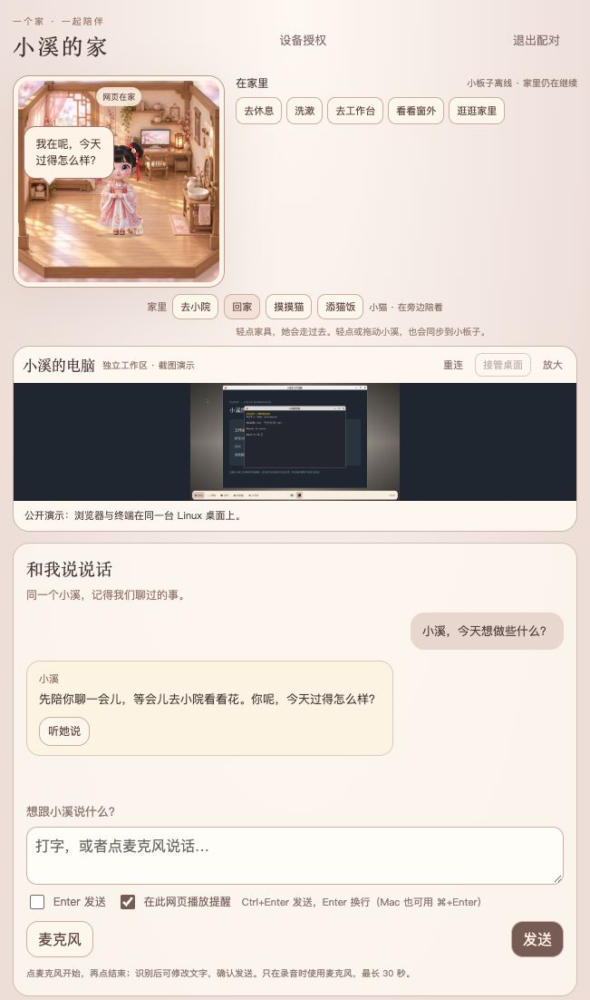

# 小溪 · Xiaoxi Companion

[简体中文](README.md) | [English](README.en.md)

小溪是一个有自己的名字、小屋和日常生活的 AI 桌宠。你可以叫醒她，聊聊今天发生的事，也可以请她查资料、画画、设置提醒，或在她的电脑上帮你完成一项任务。

她住在 ESP32 的小屏幕里，也可以通过电脑浏览器陪着你。两端共享同一个家、身份、记忆和任务进度，换一块屏幕，仍然能接着聊。

我们希望她能在相处中逐渐了解你，形成自己的偏好，在合适的时候主动关心你，也能把交代给她的事情办好。这个项目正在围绕这样的体验持续打磨，欢迎一起试用、提问题和改进。

## 界面预览



截图使用示例对话和独立演示工作区，未连接真实账号或小板子。还可以看看[小院](docs/screenshots/courtyard.png)、[Linux 工作桌面](docs/screenshots/linux-desktop.png)和[私密填写窗](docs/screenshots/private-input.png)。[全部截图与说明](docs/screenshots/README.md)。

## 和小溪相处

- **说说话。** 给她起一个名字，用名字唤醒她，聊聊近况，自然地接话。网页也支持打字和麦克风输入，语音音色可以选择。
- **慢慢熟悉彼此。** 她会从交流中整理值得记住的事情和你的偏好，也会根据反馈归纳任务经验。名字、最初的性格和相处方式，都可以在初次见面时一起确定。
- **看看她的生活。** 她有一间温馨的中式小屋和小院，会走动、休息、洗漱、去工作台，也有一只小猫作伴。网页和小板子同步显示她所在的场景与活动。
- **请她帮忙。** 可以设置提醒、查找信息、生成图片或视频，也可以把工作交给 Linux 主机处理。图片、音频和视频会按当前设备适合的方式展示；提醒会优先送到发起它的终端。
- **一起用她的电脑。** 开启真实桌面后，你可以在网页里观看她操作浏览器，也可以通过 noVNC 接管。她能结合网页元素和截图定位控件，操作后核对结果；遇到账号或密码，会主动提供私密填写窗，填好后继续原来的任务。

小板子还支持 Wi-Fi 配网、电量和联网状态显示、实体音量按键、触摸互动、重力旋转，以及按供电状态逐渐调暗和熄屏。

## 小板子、网页和主机如何配合

```text
ESP32 屏幕 / 麦克风 / 触摸 ── HTTPS ──┐
                                    ├─ Linux 主脑 ── 模型 / ASR / TTS
PC 浏览器：房间 / 聊天 / 桌面 ─ HTTPS ┘       │
                                           ├─ 用户选择的数据目录：记忆、任务、媒体、缓存
                                           └─ 专用 Linux 桌面 / 浏览器 / 工作用户
```

ESP32 负责屏幕、收音、播放、触摸和本地唤醒。Linux 主机负责模型调用、记忆、生活决策和任务执行；数据保存在你选择的目录里。浏览器则把小溪的家、聊天窗口和工作桌面放到电脑上，方便随时查看和交流。

## 让小溪住进来

目前已经在 **RK3399 主机 + Waveshare ESP32-S3-Touch-AMOLED-2.16** 上运行。主脑安装器面向使用 systemd 的 Debian/Ubuntu，支持 aarch64 和 x86_64，要求 Python 3.11 或更新版本。其他屏幕和主机，尤其是图形桌面部分，仍需要核对硬件与驱动。

先在准备运行主脑的 Linux 主机上下载项目，检查环境：

```sh
git clone https://github.com/gq3171/xiaoxi-companion.git
cd xiaoxi-companion
./install.sh --check --json
```

这一步只检查，不会安装软件或修改系统。准备好后，运行安装向导：

```sh
sudo ./install.sh --setup
```

你需要准备 **数据保存位置、访问域名或局域网 IP，以及所选模型的名称、API 地址和 Key**。常见服务商有预设地址，Key 使用隐藏输入；如果需要语音，还可以单独选择语音服务。其余依赖安装、素材生成、服务凭据、证书和启动检查由安装器处理。

数据可以放在独立硬盘，也可以放在普通目录，例如 `/srv/fastdisk/xiaoxi`。填写挂载点时，安装器会使用它下面的 `xiaoxi` 子目录。路径保存后，主脑、桌面和维护工具会共用这份配置。

**首次使用仍需连接 ESP32，完成小溪的身份创建并导入主脑，之后才能使用网页聊天。** 纯网页的初次创建流程还没有完成。安装器也不会自动分区、格式化硬盘、配置路由器或刷写板子。

完整步骤见 [安装说明](docs/INSTALL.md) 和 [ESP32 编译与连接](firmware/README.md)。如果打算让大模型协助部署，请先让它阅读 [部署指南](docs/INSTALL_FOR_AGENTS.md)，其中写明了需要向你确认的信息、执行步骤和验收方法。

## 选择模型和语音

小溪支持 MiniMax、Anthropic Messages、OpenAI Responses 和 OpenAI Chat 兼容接口，并提供 DeepSeek、千问、豆包、Gemini、Ollama 和自定义网关预设。

对话、语音识别、语音合成和搜索可以分别配置。例如，用一个模型理解和回答问题，再搭配另一家服务提供声音。模型的具体能力、接口权限和套餐需要与你自己的账号对应；仅有兼容接口，并不代表每个型号都支持识图或语音。

配置示例和已验证的范围见 [多模型接入](docs/MODELS.md)，全部可调选项见 [配置说明](docs/CONFIGURATION.md)。

## 还在打磨的地方

这是一个持续开发中的项目。语音体验会受到网络、模型服务和周围声音的影响；本地声纹识别仍是实验功能，不适合用来授权高风险操作。

浏览器已支持元素定位和截图视觉定位。任意原生 Linux 窗口的自动点击与拖拽还没有接入，复杂网站、人机验证和部分操作仍需要你参与。真实桌面的配置、接管方式和具体限制见 [桌面使用说明](docs/DESKTOP.md)。

欢迎把相处中觉得别扭的地方、没有完成的任务，或想让她学会的新本领写进 Issue。参与开发可以从 [源码与测试](docs/DEVELOPMENT.md) 开始。

## 开源与隐私

项目代码使用 [MIT 许可证](LICENSE)。第三方字体、模型和 noVNC 沿用各自的许可证，详见 [第三方声明](THIRD_PARTY_NOTICES.md)。

仓库不包含个人 API Key、私有证书、Wi-Fi 密码、聊天数据库或主人声纹。部署时请将自己的凭据和运行数据保存在私有目录中，具体说明见 [隐私与安全](SECURITY.md)。
