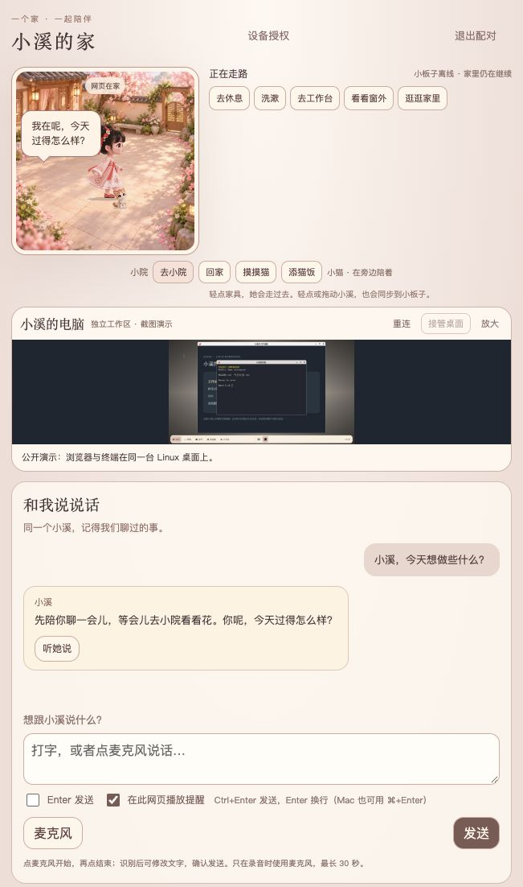
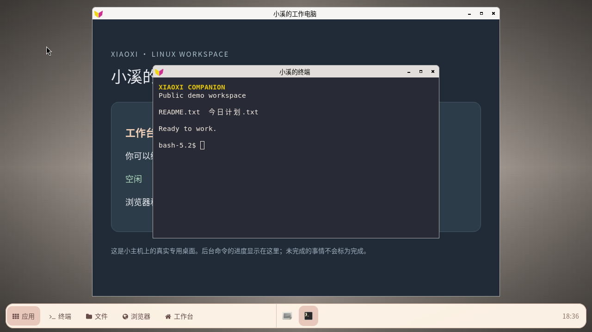
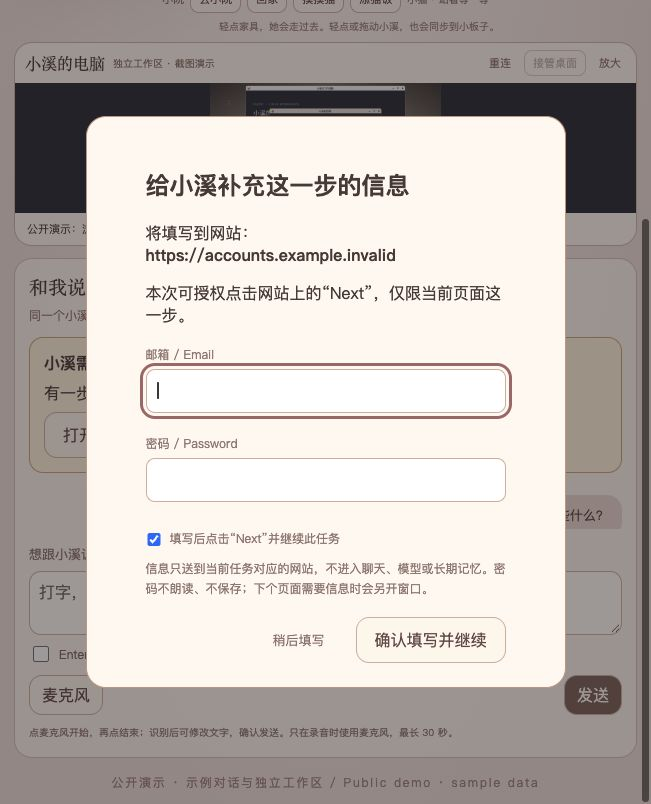

# 小溪的界面 / Screenshot gallery

这组截图使用当前网页界面、共享场景引擎和公开素材拍摄。对话为编写的示例，Linux 桌面使用独立的临时用户目录和演示文件，未读取真实聊天、账号或个人文件。演示没有连接 ESP32，因此页面会显示小板子离线。

These captures use the current web interface, shared scene engine, and public assets. Conversations are written examples; the Linux desktop uses an isolated temporary profile and demo files. No real chats, accounts, or personal files were used. No ESP32 was connected to this demo, so the device appears offline.

## 房间和聊天 / Home and chat

## 小院和小猫 / Courtyard and cat

## Linux 工作桌面 / Linux workspace

浏览器、终端和底部程序入口来自实际运行的独立 Linux 桌面。网页截图中的工作区缩略图使用这张静态截图作演示；实际部署通过 noVNC 实时查看与接管桌面。

The browser, terminal, and application dock come from a running, isolated Linux desktop. The workspace thumbnail in the web captures uses this still image for demonstration; the deployed application uses noVNC for live viewing and control.

## 私密填写 / Private input

窗口使用保留示例域名 `accounts.example.invalid`，字段保持空白，没有填写或提交任何真实凭据。

The form uses the reserved example domain `accounts.example.invalid`. Fields are empty; no real credentials were entered or submitted.

[简体中文 README](../../README.md) · [English README](../../README.en.md)
